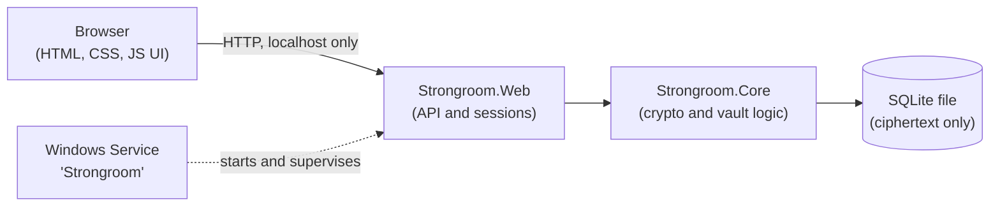

# Strongroom: Project Overview

Status: **draft for review**. This document explains how the pieces fit together and how the **Windows Service** works.
For setup steps, the security design, the API and the project layout, see the [README](../README.md).

## 1. What Strongroom is

Strongroom is a small, local-only password manager for work credentials. It is a single .NET web application that stores
everything encrypted in a SQLite file. It supports more than one user, each with their own master password and vault.
Nothing leaves the machine: it listens on localhost only and makes no external requests.

The core features (add, edit, delete, search, login, change master password) are complete.

## 2. Components at a glance

| Component | What it is | Where it lives | Address |
|---|---|---|---|
| **Web app** | ASP.NET Core app (`Strongroom.Web`): serves the UI and the JSON API | `src/Strongroom.Web` | `http://localhost:5245` (dev) or `:47245` (service) |
| **Windows Service** | The same web app, installed so Windows starts and supervises it | `C:\Apps\Strongroom` (service name `Strongroom`) | `http://localhost:47245` |
| **Core library** | Encryption, storage and vault logic, no web code | `src/Strongroom.Core` | n/a |
| **Database** | SQLite file holding only ciphertext | `C:\ProgramData\Strongroom\strongroom.db` (service) or `data\strongroom.db` (dev) | n/a |
| **Tests** | xUnit tests for crypto and vault logic | `tests/Strongroom.Tests` | n/a |
| **Deploy scripts** | Install, update and remove the service | `deploy\install.ps1`, `deploy\uninstall.ps1` | n/a |

## 3. The web app

An ASP.NET Core minimal API on .NET 10 that serves a plain HTML, CSS and JavaScript UI (no build step, no external
requests). In the UI a user can:

- Create an account (username plus a master password of at least 12 characters) and log in.
- Add, edit, delete and search credentials (name, URL, username, password, category, notes).
- Generate random passwords, and copy a password (the clipboard is cleared after 30 seconds).
- Change the master password, or lock the vault (it also locks automatically after 5 minutes idle).

More detail is in the README:

- [How data is protected and known trade-offs](../README.md#how-it-protects-your-data)
- [API endpoints](../README.md#api-all-under-api)
- [Where the database lives and how to move it](../README.md#where-your-data-lives)
- [Project layout](../README.md#project-layout)

## 4. The Windows Service

### 4.1 What it does
The service runs the web app in the background so it is always available without running `dotnet run`. The service
*is* the web server: if it is stopped, nothing listens on the port and the site does not load.

### 4.2 Service details

| Setting | Value |
|---|---|
| Service name | `Strongroom` |
| Display name | Strongroom password manager |
| Executable | `C:\Apps\Strongroom\Strongroom.Web.exe` |
| Startup type | Automatic (starts with Windows, before anyone logs in) |
| Runs as | `NT AUTHORITY\LocalService` (low privilege) |
| Recovery | Restart after 5 seconds, then after 30 seconds (failure count resets after 24 hours) |
| Port | 47245 by default (configurable) |
| Database | `C:\ProgramData\Strongroom\strongroom.db` by default (configurable) |
| Settings file | `C:\Apps\Strongroom\appsettings.Production.json` (port and database path, kept across updates) |
| Logs | Event Viewer > Windows Logs > Application, source "Strongroom" |

Hosting support comes from `Microsoft.Extensions.Hosting.WindowsServices` (`UseWindowsService`, service name
"Strongroom").

### 4.3 What the install script does (`deploy\install.ps1`)
The install command is in the [README](../README.md#run-it-as-a-windows-service-starts-with-windows). The script is
safe to re-run, and in order it:

1. Publishes a Release build to a temp folder.
2. Stops the service if it is running.
3. Copies the program files to the install directory, keeping `appsettings.Production.json`.
4. Writes `appsettings.Production.json` (port and database path). A parameter you pass wins, otherwise the existing
   setting is kept, otherwise the default is used, so an update never silently changes the port or database.
5. Creates the database folder, optionally imports the dev vault (`-ImportVault`, never overwrites an existing
   database), and grants `LocalService` modify access to that folder.
6. Creates the service (or updates its path) and sets the crash-recovery actions.
7. Checks the port is free, starts the service, and health-checks `/api/status`.

Parameters: `-InstallDir`, `-DatabasePath` (a file path, not a folder), `-Port` (1024 to 65535), `-ImportVault`.

`deploy\uninstall.ps1` removes the service and **never deletes the database**. Add `-RemoveFiles` to also delete the
install directory.

### 4.4 Everyday operations

| Task | How |
|---|---|
| Open the app | `http://localhost:47245` |
| Start, stop or restart | Services app (`services.msc`), or `Start-Service`, `Stop-Service`, `Restart-Service` with name `Strongroom` |
| Change the port | Re-run `install.ps1` with `-Port <number>` |
| Update after code changes | Re-run `install.ps1` |
| Check what is wrong | Event Viewer > Windows Logs > Application (source "Strongroom") |

## 5. Service vs `dotnet run`

| | Windows Service | `dotnet run` |
|---|---|---|
| Starts | Automatically with Windows | Manually |
| Port | 47245 | 5245 |
| Database | `C:\ProgramData\Strongroom\strongroom.db` | `data\strongroom.db` in the repo (gitignored) |
| Runs as | LocalService | Your user |
| Code changes | Re-run `install.ps1` | Picked up on restart |

They hold **different vaults**. Both can run at once, but use one day to day. Browser cookies do not separate by port, so
you may be asked to unlock again when switching between them.

## 6. Source control, build and tests

- Repository: `AIDK/strongroom` (public), branch `main`.
- Tests: `dotnet test` runs 23 xUnit tests (crypto, service register/unlock/CRUD/isolation, no plaintext in the database,
  blob swapping, master password change). Test passwords are generated at runtime.
- CI: the GitHub Actions workflow "Build and test" runs on every pull request and push to `main`.
- `main` is protected: pull request required, 1 approval, code owner review, passing "Build and test" required
  (admin bypass is allowed). GitGuardian scans pull requests.

## 7. Open points for review

- Should the service port or install directory defaults change?
- Is a LICENSE file wanted for the public repo?
